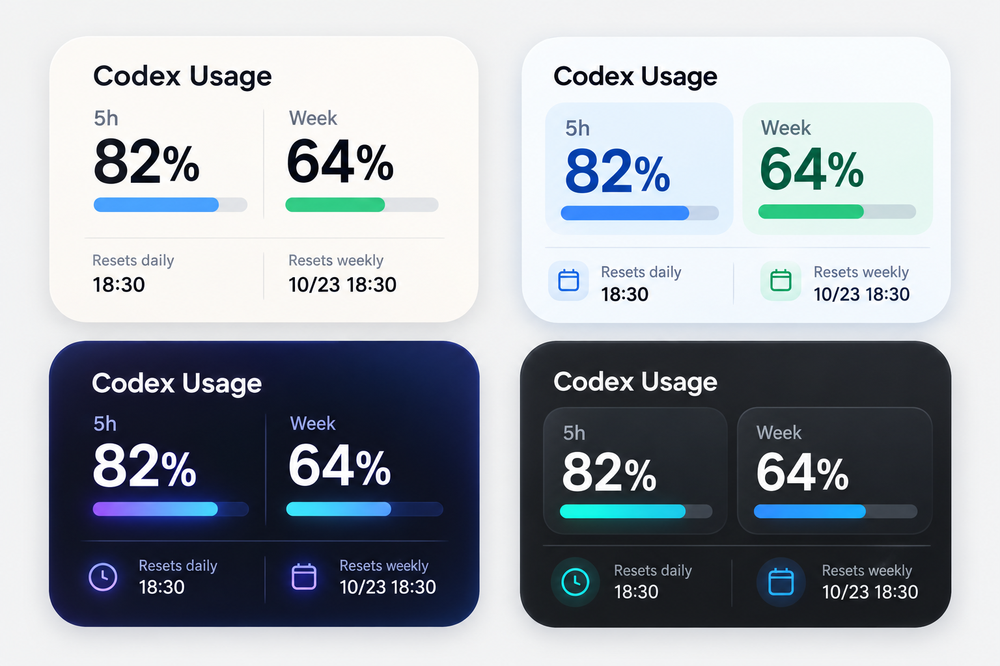
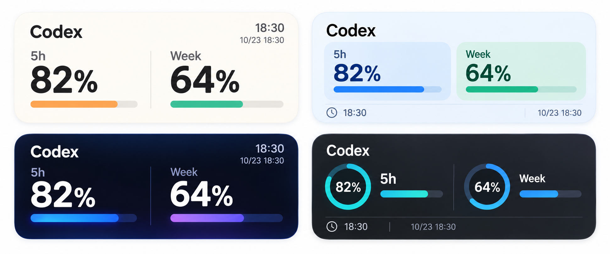

# Codex Usage Widget for Scriptable

A local iPhone widget that completes Codex device authorization, reads usage, and displays the 5-hour and weekly limits in Scriptable. Its standout feature is showing the **next reset as a specific local date and clock time** (for example, `10/23 18:30`) directly below each percentage, instead of only a countdown. No server deployment or Codex CLI is required: authorization and usage lookup run from Scriptable on the iPhone. Tokens are stored in Scriptable Keychain on the device. The widget does not send tokens or usage data to Cloudflare or to this repository.

> **核心特点：直接显示下次重置的具体日期和时刻**，例如 `10/23 18:30`，并按 iPhone 当前时区展示在额度百分比下方，不只是显示“还剩 4 小时”。**无需部署服务，无需安装或运行 Codex CLI**，直接在 iPhone 的 Scriptable 中授权和查询。

## 中文使用说明

### 功能

- 无需部署 Cloudflare 或其他服务，也无需 Codex CLI；直接在 iPhone 的 Scriptable 中完成授权和查询。
- 在 Scriptable 中完成 Codex 设备授权，不需要手动复制刷新令牌。
- 从 OpenAI 用量接口读取 5 小时和周额度。
- 中号横向小组件显示百分比、进度条和**下次重置的具体日期与时刻**，不只显示倒计时。
- 小号组件也显示 5 小时与周额度的重置日期和时间。
- 浅色外观为暖白极简风，深色外观自动切换为深蓝霓虹风。
- 重置时间优先使用用量接口返回的下次重置时间，并按 iPhone 当前时区显示为 `MM/dd HH:mm`；若接口仅提供剩余秒数，则由当前时间换算。
- 刷新令牌保存在本机 Scriptable Keychain；本项目不连接 Cloudflare。

### 安装与首次授权

1. 在 iPhone 安装 **Scriptable**。
2. 打开本仓库的 [`Scriptable/CodexUsageWidget.js`](Scriptable/CodexUsageWidget.js)，复制全部代码。
3. 打开 Scriptable，点右上角 **＋** 新建脚本，将代码粘贴进去并保存，例如命名为 `Codex Usage`。
4. 在 Scriptable 中运行脚本。首次运行会请求设备授权并显示一次性代码。
5. 按提示打开授权网页，登录 ChatGPT/Codex 账号并输入代码；返回 Scriptable 后点 **“我已授权，继续”**。脚本会轮询授权结果、保存令牌并读取用量。
6. 确认 Scriptable 中能显示用量后，继续添加主屏幕小组件。

### 添加横向小组件

1. 长按 iPhone 主屏幕空白处，点 **＋**。
2. 搜索并选择 **Scriptable**，选择中号（横向）小组件并添加。
3. 长按刚添加的小组件，选 **编辑小组件**。
4. 在 **Script** 中选择刚才保存的 `Codex Usage`。
5. 如需立即刷新，在 Scriptable 中再次运行该脚本。iOS 会自行安排主屏幕小组件的后续刷新时间。

中号组件将 5 小时和周额度并排显示，重置日期和时间位于各自百分比正下方并居中；小号组件也会显示两项额度的重置时间。标题带有代码风格图标，不显示右上角的 LIVE 状态。图片为设计方向示意，实际界面由 Scriptable 和 iOS 渲染。

### 重新授权

在 Scriptable 中手动运行脚本，选择 **“重新授权”**，然后按设备授权提示操作。重新授权成功后会覆盖本机保存的刷新令牌。

### 隐私与注意事项

- 令牌写入 iOS 上 Scriptable 的 Keychain，不嵌入脚本源码或上传到仓库。
- 查询请求由 iPhone 直接发送到 OpenAI 的认证和用量接口；不经 Cloudflare Worker。
- 本脚本使用 Codex/ChatGPT 的内部接口，接口或授权流程可能调整。设备授权接口若不可用，请稍后重试或等待脚本更新。
- 不要把刷新令牌、设备授权代码或账号凭据贴到 issue、聊天或公开截图中。
- 本项目是社区脚本，与 OpenAI 无官方关联。使用前请自行确认账号及服务条款适用情况。

### 常见问题

**设备授权时出现 HTTP 404 或授权服务错误**  
这通常表示当前账号或服务端暂不提供设备授权流程。稍后重试；不要反复分享或复用已过期的一次性代码。

**小组件显示空白或旧数据**  
先在 Scriptable 应用中手动运行脚本，确认授权仍有效、用量能正常显示。iOS 控制小组件的刷新频率，`refreshAfterDate` 不代表系统一定会在该时刻刷新。

**深色外观没有切换**  
确认 iPhone 已切换到深色模式，并重新运行一次脚本让小组件刷新。

## English instructions

### Features

- Completes Codex device authorization in Scriptable; no manual refresh-token copy is needed.
- Reads 5-hour and weekly limits from the OpenAI usage endpoint.
- The standout feature is an **absolute next-reset date and clock time** (for example, `10/23 18:30`) directly below each percentage, rather than only a countdown.
- The medium landscape widget shows percentages, progress bars, and next-reset times.
- The small widget also shows reset date and time for both usage windows.
- The light appearance uses a warm minimal palette; dark appearance switches to a midnight blue neon palette.
- The widget uses the reset timestamp returned by the usage endpoint and displays it in the iPhone's local time zone as `MM/dd HH:mm`. If the endpoint only supplies seconds remaining, the widget calculates the corresponding local time.
- No Cloudflare or other server deployment and no Codex CLI are required; authorization and usage lookup run directly in Scriptable on the iPhone.
- The refresh token is stored in Scriptable Keychain on the iPhone. This project does not connect to Cloudflare.

### Install and authorize

1. Install **Scriptable** on your iPhone.
2. Open [`Scriptable/CodexUsageWidget.js`](Scriptable/CodexUsageWidget.js) in this repository and copy the entire file.
3. In Scriptable, tap **＋** to create a script, paste the code, and save it (for example, as `Codex Usage`).
4. Run the script in Scriptable. On first run it starts device authorization and shows a one-time code.
5. Open the authorization page, sign in to your ChatGPT/Codex account, and enter the code. Return to Scriptable and tap **“I have authorized, continue.”** The script polls for approval, stores the token, and loads usage.
6. Once usage appears in Scriptable, add the home screen widget.

### Add the landscape widget

1. Long-press an empty area of the iPhone Home Screen and tap **＋**.
2. Find **Scriptable**, choose the medium (landscape) widget, and add it.
3. Long-press the new widget and choose **Edit Widget**.
4. Under **Script**, select the `Codex Usage` script you saved.
5. To refresh immediately, run the script from the Scriptable app. iOS schedules later widget refreshes at its discretion.

The medium widget places the 5-hour and weekly limits side by side, with each reset date and time centered directly below its percentage. The small widget also shows both reset times. The title includes a code-style mark and omits the LIVE badge. Images are visual concepts; Scriptable and iOS render the actual widget.

### Reauthorize

Run the script manually in Scriptable and choose **“Reauthorize”**, then follow the device authorization prompt. A new successful authorization replaces the locally saved refresh token.

### Privacy and notes

- The token is stored in Scriptable Keychain on the iPhone. It is not embedded in the source or uploaded to this repository.
- Usage requests go directly from the iPhone to OpenAI authentication and usage endpoints; they do not pass through a Cloudflare Worker.
- This script uses internal Codex/ChatGPT endpoints and the authorization flow may change. If device authorization is unavailable, retry later or wait for an update.
- Never post refresh tokens, one-time device codes, account credentials, or screenshots containing them in issues, chats, or public posts.
- This is a community script and is not affiliated with OpenAI. Check that its use is appropriate for your account and applicable service terms.

### Troubleshooting

**HTTP 404 or an authorization error during device login**  
The device authorization flow may not currently be available for your account or on the service. Retry later. Do not share or reuse an expired one-time code.

**The widget is blank or shows old data**  
Run the script manually in Scriptable and confirm authorization is still valid and usage loads. iOS controls widget refresh frequency; `refreshAfterDate` is a requested refresh time, not a guarantee.

**Dark appearance did not update**  
Switch the iPhone to Dark Mode and run the script once to refresh the widget.

## Design concepts

These images compare visual directions for the widget. The figures are illustrative, not live account data.

### Square/widget direction comparison

### Medium landscape widget comparison

## License

MIT. See [LICENSE](LICENSE). The design/code derives in part from the MIT-licensed [Codex Usage Scriptable Widgets](https://github.com/qian-available/codex-usage-scriptable-widgets).
